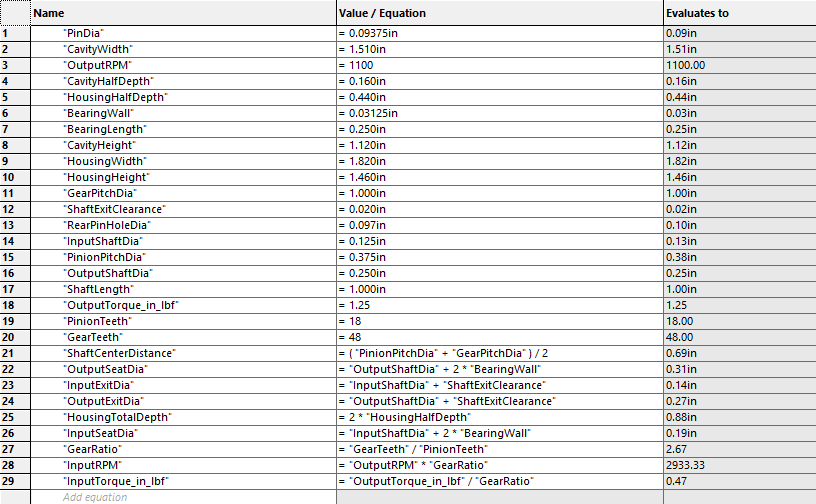
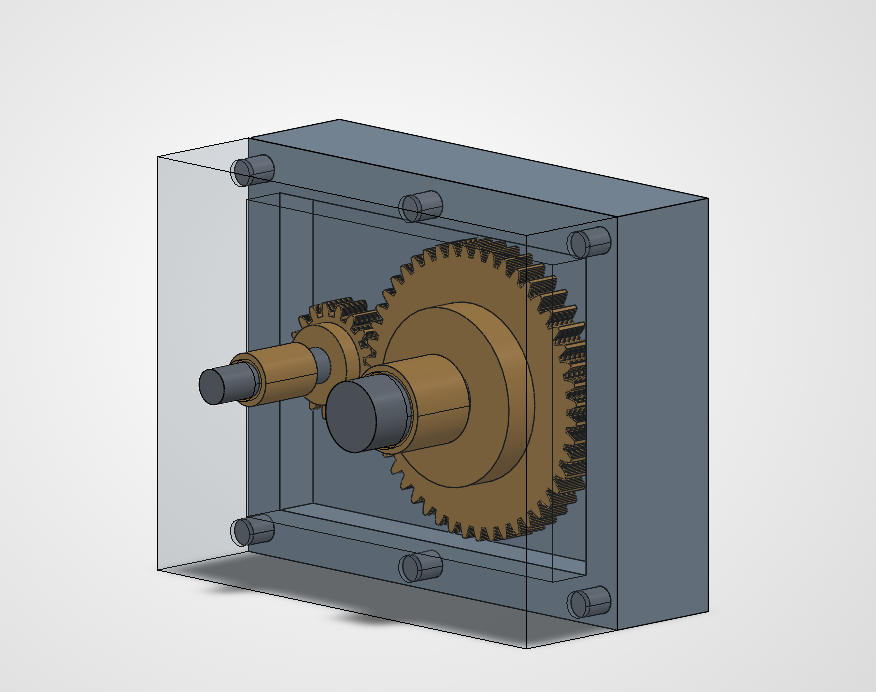
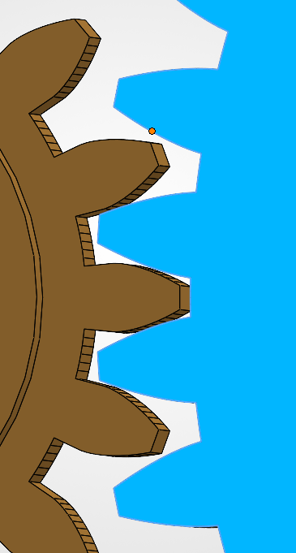
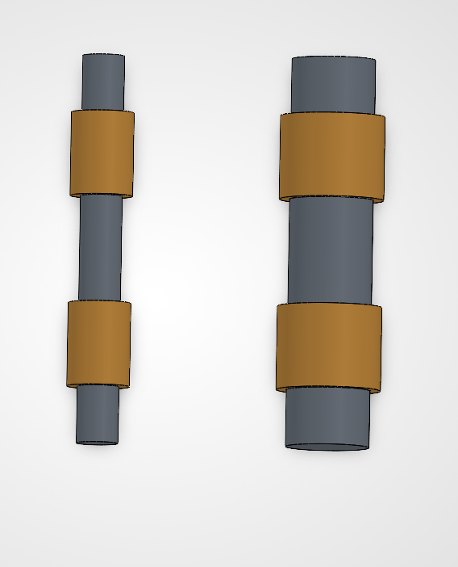
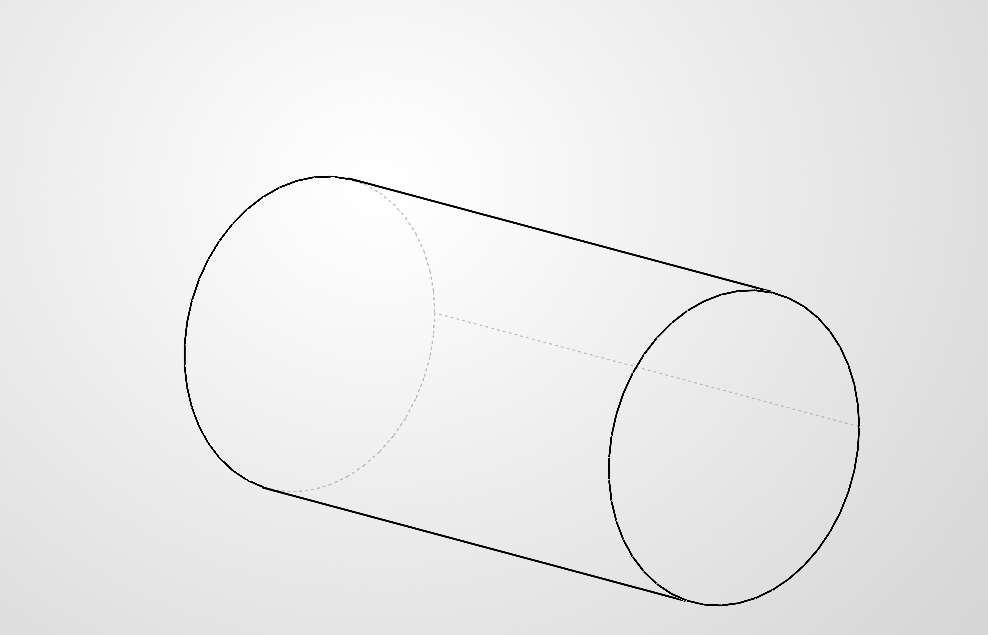

# A8 – Gears

## Objective

Design a gearbox that can be assembled and disassembled.

Analyze and size input and output shafts for strength.

Design journal bearings to support shafts.

Create a gearbox housing with proper clearance and fastening.

Use parametric CAD modeling to generate a final design.

Document calculations, sketches, and lessons learned.

## Design of the Shafts

### Input Shaft 

I began designing the input shaft by listing knowns and unknowns. From there, I calculated the speed and torque needed for the shear stress calculations. Below are the listed knowns, unknowns, and work for said unknowns. 

 

The calculated maximum torsional shear stress is 1,222.31 psi, below the assumed allowable shear stress of 4,000 psi. Therefore, the specified 0.125-inch input shaft diameter is sufficient under the simplified torsional model. No diameter increase is required.

### Output Shaft

Following the same process for the output shaft, I used the given output torque for this calculation instead of calculating it. 

The output shaft’s calculated maximum torsional shear stress is 407.44 psi, below the assumed allowable shear stress of 8,500 psi. Therefore, the specified 0.250-inch diameter is sufficient under the simplified torsional model. No diameter increase is required.

## Design journal bearings

### Size, length, pressure, velocity, and PV rating of the journal bearing

Once again, I began this section by listing knowns and unknowns, as well as assumptions and design choices for the bearings. With these listed, I calculated the desired unknowns, acquiring a conservative design of the bearings. An important note is that each shaft needs two bearings, as the shafts extend through the housing box.   

Porous bronze is selected for the journal bearings. With a bearing length of 0.250 inch, the calculated pressure, velocity, and pressure–velocity product are below the respective porous-bronze limits in the lecture table for both shaft locations. Each bearing was checked using the full resultant gear force as a conservative design load.

### Design the thickness of the journal bearings

I selected a trial radial wall thickness of 0.03125 in for both bearings. The thick-wall model gave maximum hoop stresses of 221.34 psi for the input bearing and 193.93 psi for the output bearing. Substituting each calculated stress into the allowable-stress term of the thickness equation recovered the trial thickness of 0.03125 in for both bearings.

### Select the journal bearings.

I selected oil-embedded 841 bronze sleeve bearings from McMaster-Carr. The input shaft uses two 6391K753 bearings for a 1/8-in shaft and a 3/16-in housing bore. The output shaft uses two 6391K126 bearings for a 1/4-in shaft and a 5/16-in housing bore. Both are 1/4 in long. Using the nominal diameters, the radial wall thickness is (0.18750-0.12500)/2 = 0.03125 in for the input bearing and (0.31250-0.25000)/2 = 0.03125 in for the output bearing. The pressure, velocity, and PV values calculated in Section 2a are within the lecture limits for porous bronze.

## Sketch a two-component gearbox housing fitted together

The gearbox housing consists of a body and a removable face. Six pins around the perimeter align the two halves. The face separates from the body along the shaft axes to provide access to the gears and bearings. Each shaft is supported by two sleeve bearings, one on each side of its gear. 

## CAD Model

### Parametrically generate critical features of a solid model

The gearbox layout starts with the gear pitch diameters, shaft diameters, and selected bearing dimensions. The 0.375 in pinion pitch diameter and 1.000 in gear pitch diameter give a shaft center distance of 0.6875 in. The nominal input and output bearing seats are 0.1875 in and 0.3125 inches in diameter, respectively. The assembled housing measures 1.820 in wide, 1.460 in high, and 0.880 in deep. Oil-embedded 841 bronze was selected for the sleeve bearings. 

The SolidWorks Equations window parametrically records the design inputs and calculated dimensions.

### CAD Model

Assembled gearbox. The housing face is transparent in this view so the two gears and their placement inside the housing can be seen.

Gear mesh detail. The close-up shows the relative positions of the pinion and gear teeth at the selected shaft spacing.

Shafts and sleeve bearings. The 0.125 in input shaft is on the left, and the 0.250 in output shaft is on the right. Each shaft uses two 0.250 in long sleeve bearings.

Housing alignment pin. Six pins of this type are positioned around the perimeter to align the housing body and removable face.

## Lessons Learned

I learned how the gear dimensions affect the shaft layout and the bearing selection. The pitch diameters set the shaft spacing, while the gear force and shaft speed determine the bearing pressure and sliding speed. I also learned to check pressure, velocity, and PV when selecting bearing material.

One issue I worked through was the difference between choosing a trial bearing wall thickness and finding a minimum thickness from a material allowable. I am still unsure if I did this correctly. I used a 0.03125 in trial wall, calculated the hoop stress for each bearing, and substituted those stresses back into the thickness equation to recover the trial value.

Total Time Spent: 7 hours

