# A8 – Gears

## Objective

Design a gearbox that can be assembled and disassembled.

Analyze and size input and output shafts for strength.

Design journal bearings to support shafts.

Create a gearbox housing with proper clearance and fastening.

Use parametric CAD modeling to generate a final design.

Document calculations, sketches, and lessons learned.

## Design of the Shafts

### Input Shaft 

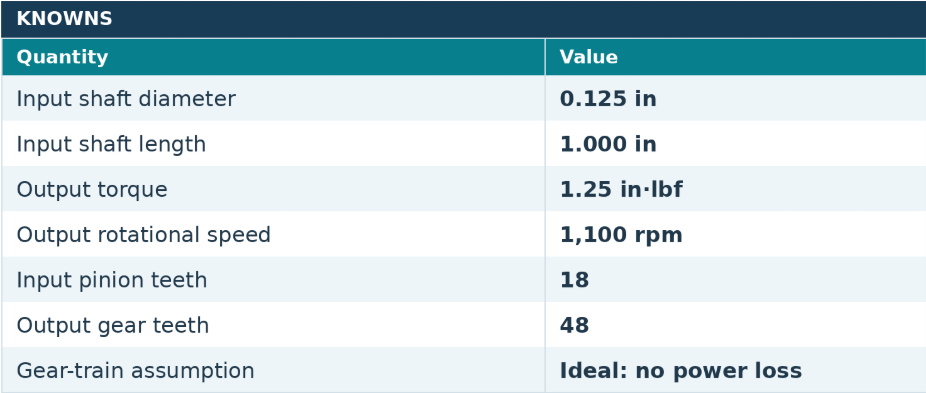
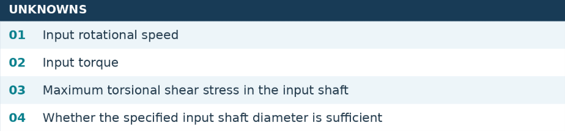 
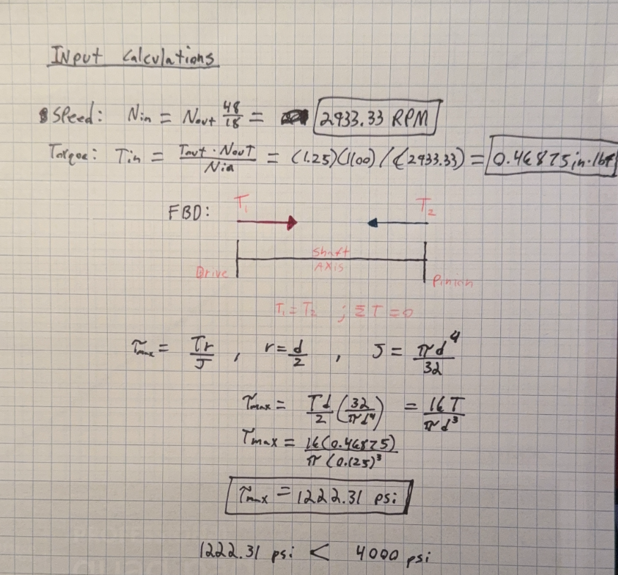

The calculated maximum torsional shear stress is 1,222.31 psi, below the assumed allowable shear stress of 4,000 psi. Therefore, the specified 0.125-inch input shaft diameter is sufficient under the simplified torsional model. No diameter increase is required.

### Output Shaft

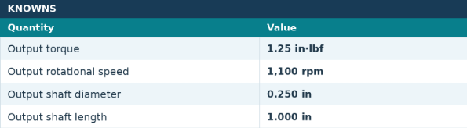
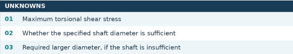
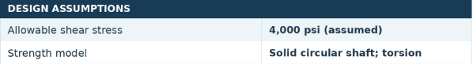
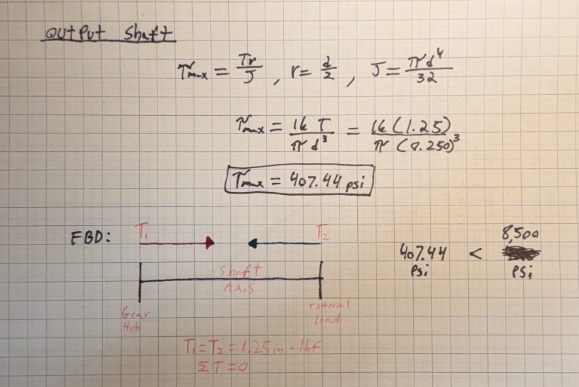

The output shaft’s calculated maximum torsional shear stress is 407.44 psi, below the assumed allowable shear stress of 8,500 psi. Therefore, the specified 0.250-inch diameter is sufficient under the simplified torsional model. No diameter increase is required.

## Design journal bearings

### Size and length of the journal bearing; the pressure, velocity, and PV rating

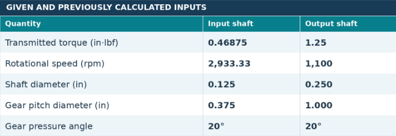

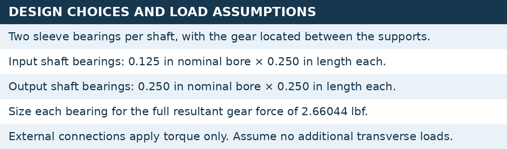
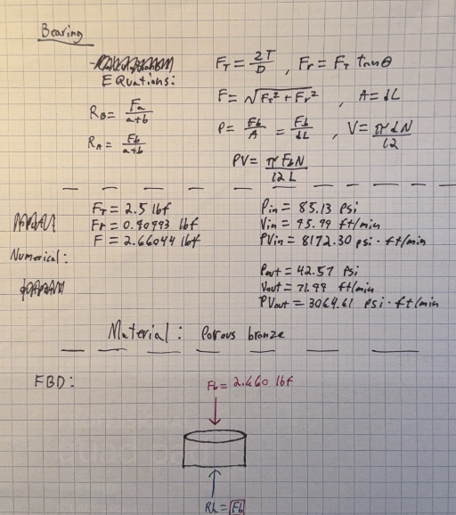
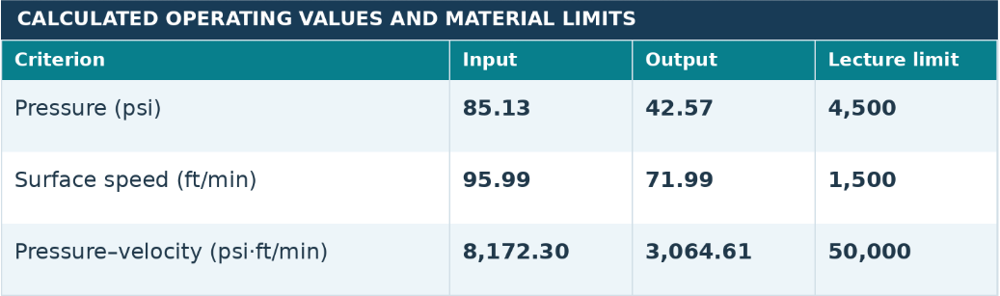

Porous bronze is selected for the journal bearings. With a bearing length of 0.250 inch, the calculated pressure, surface speed, and pressure–velocity product are below the respective porous-bronze limits in the lecture table for both shaft locations. Each bearing was checked using the full resultant gear force as a conservative design load.

### Design the thickness of the journal bearing

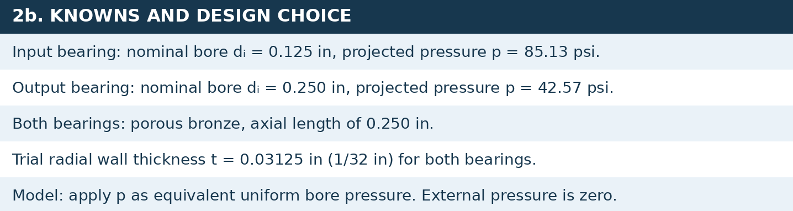
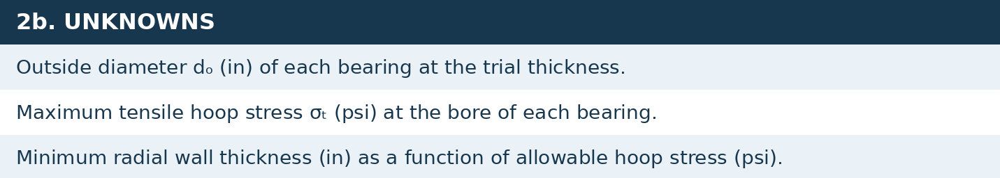
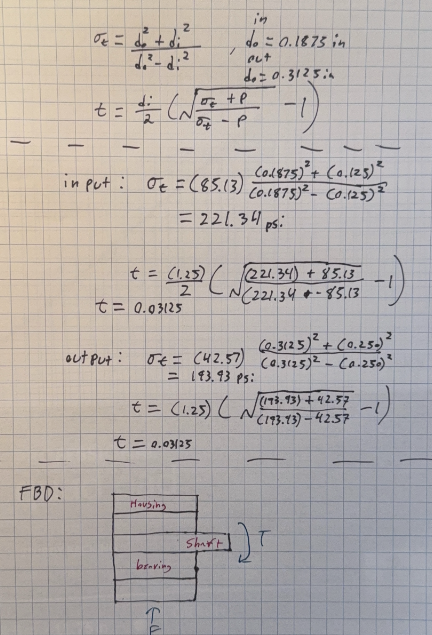

I selected a trial radial wall thickness of 0.03125 in for both bearings. The thick-wall model gave maximum hoop stresses of 221.34 psi for the input bearing and 193.93 psi for the output bearing. Substituting each calculated stress into the allowable-stress term of the thickness equation recovered the trial thickness of 0.03125 in for both bearings.

### Select the journal bearings.

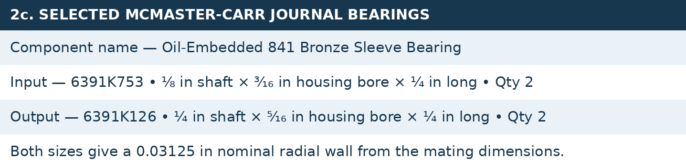

I selected oil-embedded 841 bronze sleeve bearings from McMaster-Carr. The input shaft uses two 6391K753 bearings for a 1/8-in shaft and a 3/16-in housing bore. The output shaft uses two 6391K126 bearings for a 1/4-in shaft and a 5/16-in housing bore. Both are 1/4 in long. Using the nominal diameters, the radial wall thickness is (0.18750-0.12500)/2=0.03125 in for the input bearing and (0.31250-0.25000)/2=0.03125 in for the output bearing. The pressure, surface speed, and PV values calculated in Section 2a are within the lecture limits for porous bronze.

## Sketch a two-component gearbox housing fitted together

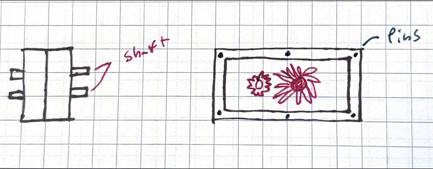

## Generate a CAD Model of the two halves of the gearbox.

### Where appropriate, parametrically generate critical features of a solid model starting with the known parameters and finishing with the dimensions and material.

### Download the necessary items from Mac-Master

### Generate the rest of the solid model.

##  Detail Lessons Learn throughout the assignment. No lesson too small. Time spent

